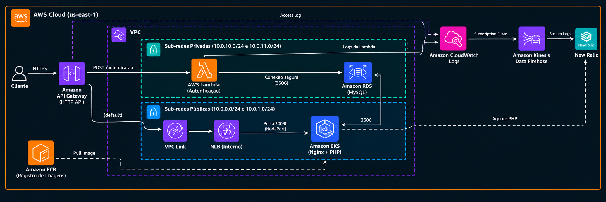

# tech-challenge-infra-db

Banco de dados gerenciado do Tech Challenge: uma instância **Amazon RDS MySQL** nas sub-redes privadas da VPC criada pelo [tech-challenge-infra-k8s](https://github.com/oesleik/tech-challenge-infra-k8s).

Este repositório cria só a instância e a rede de acesso a ela. O schema (migrations) e os usuários do banco são responsabilidade da aplicação ([tech-chalange](https://github.com/oesleik/tech-chalange)): o deploy dela roda o job `rds-user-setup` e as migrations.

| Repositório | Papel |
|---|---|
| [tech-challenge-infra-k8s](https://github.com/oesleik/tech-challenge-infra-k8s) | VPC, EKS, ECR, API Gateway, New Relic |
| **tech-challenge-infra-db** (este) | Amazon RDS MySQL |
| [tech-chalange](https://github.com/oesleik/tech-chalange) | Aplicação PHP (Helm no EKS) |
| [tech-challenge-lambda](https://github.com/oesleik/tech-challenge-lambda) | Lambda de autenticação (`POST /autenticacao`) |

## Tecnologias

- Terraform (provider `aws`), com state remoto no S3 e lock no DynamoDB
- Amazon RDS for MySQL (gp3, criptografado, sem acesso público)
- AWS Systems Manager Parameter Store (contrato entre repositórios)
- GitHub Actions com OIDC

## Arquitetura



O diagrama mostra a solução inteira. Este repositório cria só o **Amazon RDS (MySQL)** `tech-challenge-mysql` nas sub-redes privadas, com seu security group, e a regra 3306 a partir do EKS. A VPC, as sub-redes e o EKS vêm do [infra-k8s](https://github.com/oesleik/tech-challenge-infra-k8s), lidos do SSM (`network/*`, `eks/cluster_security_group_id`). A Lambda vem do [tech-challenge-lambda](https://github.com/oesleik/tech-challenge-lambda), que cria a própria regra de acesso ao banco. Ao final do apply, o endpoint e o SG são publicados em `db/*`.

### Quem cria cada regra de acesso ao banco

O security group do RDS não tem regras inline. Cada acesso é um recurso separado, criado por quem **sobe depois**:

| Origem | Regra criada em | Por quê |
|---|---|---|
| EKS (cluster SG) | este repositório | O cluster já existe quando o banco sobe |
| Lambda | tech-challenge-lambda | A Lambda sobe depois e lê `db/security_group_id` |

Assim nenhum repositório precisa conhecer algo que ainda não existe, e não há dependência circular entre states. A contrapartida é que o destroy deste repositório precisa esperar a Lambda sair (ver [Ordem entre repositórios](#ordem-entre-repositórios)).

## Contrato SSM

Consumido (publicado pelo infra-k8s):

| Parâmetro | Uso |
|---|---|
| `/tech-challenge/network/vpc_id` | VPC do security group |
| `/tech-challenge/network/private_subnet_ids` | DB subnet group |
| `/tech-challenge/eks/cluster_security_group_id` | Ingress 3306 a partir do EKS |

Publicado ([`terraform/contract.tf`](terraform/contract.tf)):

| Parâmetro | Consumido por |
|---|---|
| `/tech-challenge/db/address` | app (`DB_HOST`), lambda |
| `/tech-challenge/db/port` | lambda |
| `/tech-challenge/db/name` | lambda |
| `/tech-challenge/db/security_group_id` | lambda (regra de ingress) |

O nome da instância (`tech-challenge-mysql`) também é um contrato, só que implícito: o dashboard e os alertas do New Relic, no infra-k8s, filtram por ele.

## Pré-requisitos

Setup manual da conta (bucket do state, tabela de lock, role OIDC): ver [runbook AWS](https://github.com/oesleik/tech-chalange/blob/master/docs/infrastructure/runbook_aws.md).

| Tipo | Nome | Uso |
|---|---|---|
| Variable | `AWS_ROLE_ARN_APPLY` | Role OIDC de deploy/destroy |
| Variable | `TF_STATE_BUCKET` | Bucket S3 do state |
| Variable | `TF_STATE_LOCK_TABLE` | Tabela DynamoDB de lock |
| Secret | `DB_ROOT_PASSWORD` | Senha do usuário master `dbadmin` (32+ caracteres). **Precisa ser igual** ao secret de mesmo nome no tech-chalange, usado pelo job `rds-user-setup` |

## Deploy

**Actions → Deploy → Run workflow** (branch `master`, escolha a classe da instância). O workflow:

1. Verifica se o infra-k8s já publicou `network/*` e `eks/cluster_security_group_id`. Se não, aborta com uma mensagem clara.
2. Roda `terraform plan` e `apply` (state `tech-challenge/infra-db.tfstate`). A criação do RDS leva cerca de 5 a 10 minutos.
3. Mostra o endpoint e os parâmetros SSM publicados no summary.

Próximo passo da cadeia: **Deploy** do [tech-chalange](https://github.com/oesleik/tech-chalange).

### Ordem entre repositórios

```
Deploy:  infra-k8s → infra-db → app → lambda
Destroy: lambda → app → infra-db → infra-k8s
```

O **Destroy** deste repositório se recusa a rodar enquanto existirem parâmetros em `/tech-challenge/{app,lambda}`. Sem essa verificação, o destroy do security group ficaria preso até o timeout por causa da regra da Lambda.

### Execução local (opcional)

```bash
cd terraform
terraform init \
  -backend-config="bucket=<TF_STATE_BUCKET>" \
  -backend-config="key=tech-challenge/infra-db.tfstate" \
  -backend-config="region=us-east-1" \
  -backend-config="dynamodb_table=<TF_STATE_LOCK_TABLE>"
TF_VAR_rds_master_password='<DB_ROOT_PASSWORD>' terraform plan -var-file=env/aws.tfvars
```

## CI

[`ci.yml`](.github/workflows/ci.yml) roda em PR e em push na `master`: `terraform fmt -check`, `init -backend=false` e `validate`, sem credenciais AWS.

## APIs

Este repositório não expõe API. O banco é acessado só pela aplicação e pela Lambda, de dentro da VPC.
